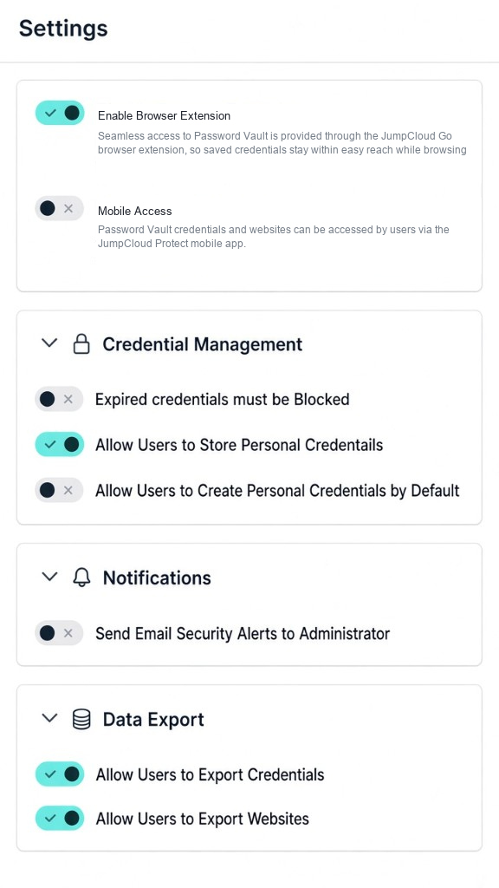

# Technical Writer Candidate Assignment

## Overview

- As part of your application for Technical Writer at JumpCloud, complete the following exercises so we can evaluate your writing, editorial judgment, and docs-as-code workflow.
- Assume your audience has **zero previous knowledge** of the technologies you’re documenting. Have fun, get creative, and show us your best work.
- We will never use this assessment in a live customer environment. Your submission is confidential between you and the JumpCloud recruiting / review teams.
- We evaluate for grammatical accuracy, clarity, formatting and design, technical judgement, and how you work in GitHub.
- We’re sensitive to your time. **Do not spend more than two (2) hours** on this assessment.
- We aim to review your exercise and provide feedback within 72 hours (3 business days).

## Prerequisites

### JumpCloud Admin Portal (Exercise A)

You will receive access to a free JumpCloud account for assignment purposes.

- JumpCloud will send you a link to sign up for an account. You do not need to request an org yourself.
- JumpCloud will have full access to your testing environment.
- After you receive the email (**Subject:** JumpCloud Administrator Account Setup) making you an administrator, you have **one hour** to reset your password before it times out. Complete this in the allotted window.
  - If you miss the window, email **recruiting@jumpcloud.com**.

### GitHub

- A GitHub account
- Comfort creating a repo from a template, working on a branch, committing Markdown, opening a pull request, and managing repository collaborators

### AI tools

You **may** use generative AI tools (ChatGPT, Claude, Cursor, Copilot, etc.) for this assessment.

If you use AI, you must:

1. Disclose what you used and briefly how (see the pull request template).
2. Act as the final quality filter: verify steps in the JumpCloud Admin Portal (Exercise A), catch hallucinations, protect security-sensitive wording, and match JumpCloud’s product behavior.
3. Not submit unedited AI output as your own work.

Undisclosed AI use, or AI output that is clearly unverified against the product, will be evaluated negatively.

## How to submit (GitHub)

This repository is a **public template**. It only contains the assignment prompt. Your work stays in **your** private copy so other candidates cannot see it.

### 1. Create your private copy

1. On this repository’s GitHub page, click **Use this template** → **Create a new repository**.
2. Create it under your personal GitHub account (name it whatever you like).
3. Make sure your configuration visibility settings are set to **Private**. 

Do **not** fork this repository. Do **not** open a pull request against this public template repo.

### 2. Complete the exercises

1. Clone your private repository.
2. Create a branch, for example: `exercise/<your-lastname>`.
3. Complete Exercises A–C by adding your files under `candidate/` (see structure below).
4. Open a **pull request** from your branch into **your private repo’s** `main` branch.
5. Fill out the pull request template completely, including the AI disclosure section.

### 3. Submit to JumpCloud

1. In your private repo, go to **Settings → Collaborators** and invite the interviewer GitHub username(s) your recruiter provides (and/or recruiting, if instructed).
2. Email **recruiting@jumpcloud.com** (and any recruiter who contacted you) with:
   - The link to your **private repository**
   - The link to your **pull request**
   - Confirmation that you added the requested collaborator(s)

Until you add collaborators, only you can see your work.

### Expected file layout in your PR

```text
candidate/
  exercise-a-add-user.md      # Exercise A
  exercise-b-radius.md         # Exercise B (your improved article)
  exercise-c-ux-copy.md        # Exercise C
```

You may add an `images/` folder under `candidate/` for screenshots if helpful (keep files reasonably sized).

---

## Exercise A — Help article (Admin Portal)

After signing up and logging into the JumpCloud Admin Portal, write a help article for completing a common task, like **adding a new user**.

**Deliverable:** `candidate/exercise-a-add-user.md`

**Guidance:**

- Write for an IT admin who is new to JumpCloud.
- Include clear prerequisites, steps, and expected results.
- Use headings, lists, and formatting that would fit a modern help center.
- Note where screenshots would appear (or embed them if you capture any).
- Validate your steps in the product before you submit.

---

## Exercise B — Edit for readability

Review the draft help article in [`ExerciseB_RADIUSDraft.md`](./ExerciseB_RADIUSDraft.md). Improve readability by reorganizing, formatting, editing errors, and rewriting for clarity. Indicate where screenshots would help.

**Deliverable:** `candidate/exercise-b-radius.md` (your revised version — do not only leave comments; ship an improved article)

You may optionally add a short “Editor’s notes” section at the bottom of that file summarizing major changes.

---

## Exercise C — UX copy (short)

Using the same “add a user” mental model from Exercise A, rewrite product microcopy for an IT admin.

**Deliverable:** `candidate/exercise-c-ux-copy.md`

Provide improved copy for **all** of the following (keep each string concise; note character limits if you assume any):



Also include **2–3 sentences** on your voice/tone choices for IT admins (clarity, risk, and action).

---

## What “good” looks like

- Accurate steps that match the product (Exercise A)
- Clear information hierarchy and scannable formatting (A & B)
- Strong editorial judgment on a messy draft (B)
- Concise, actionable UX copy (C)
- A clean GitHub PR: meaningful commits, complete PR description, honest AI disclosure

Thank you for your time and interest in JumpCloud. We look forward to seeing your work.
